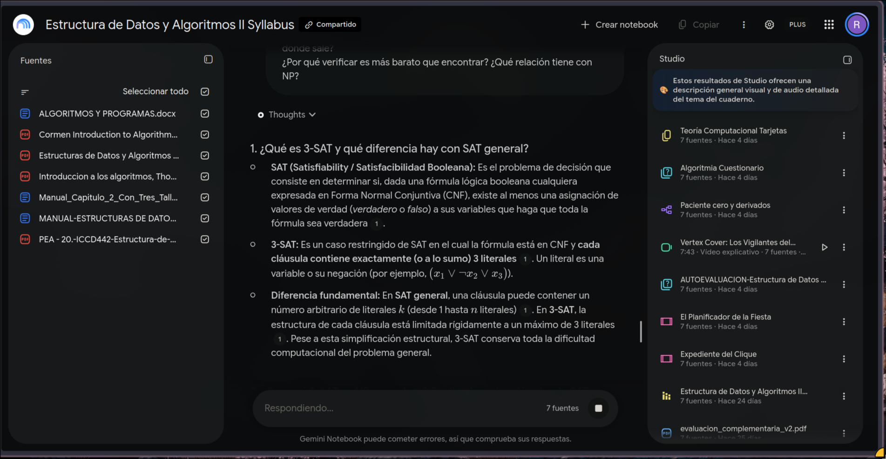
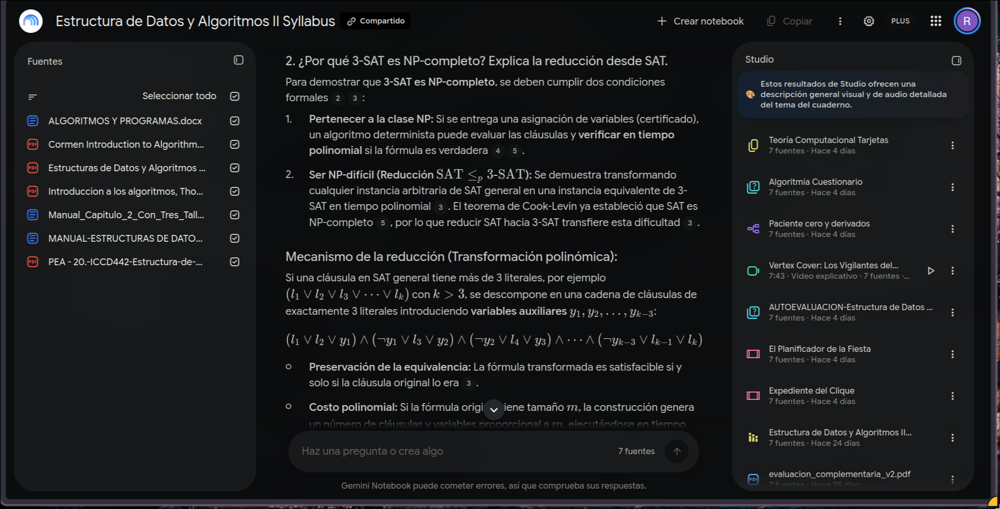
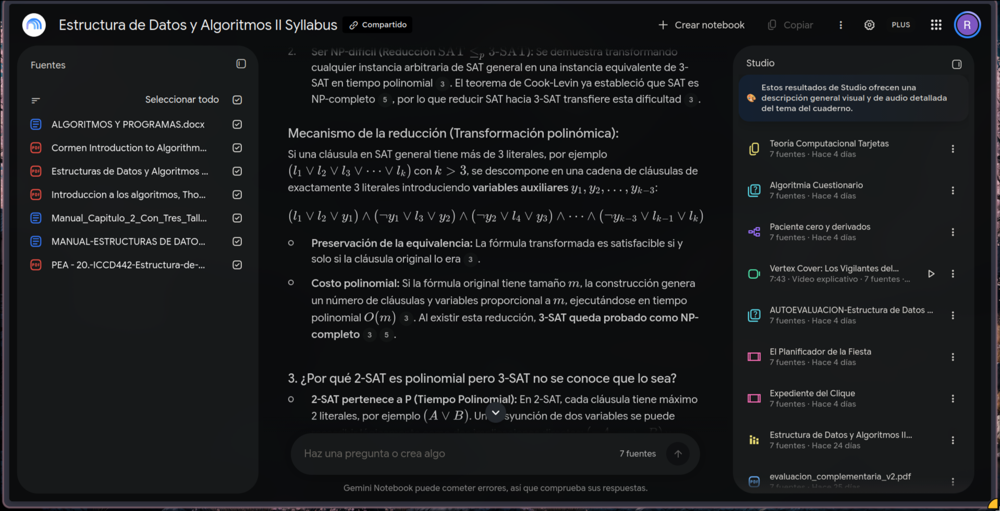
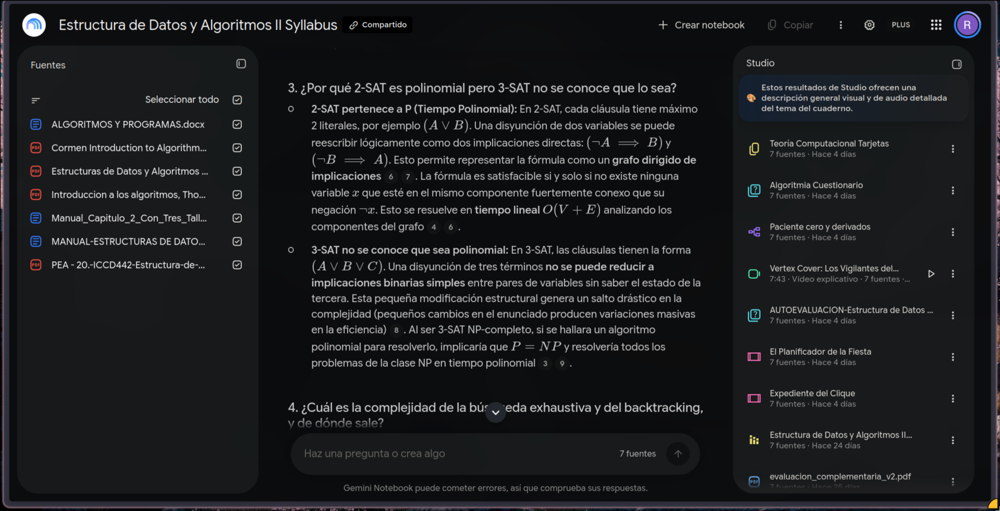
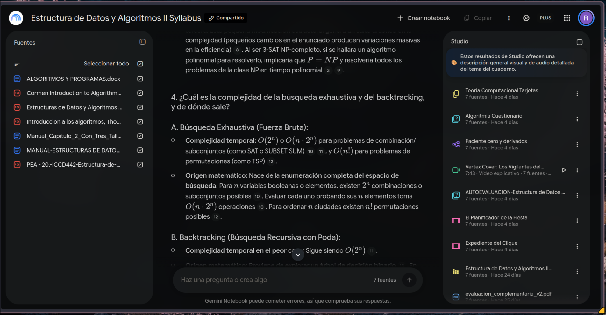
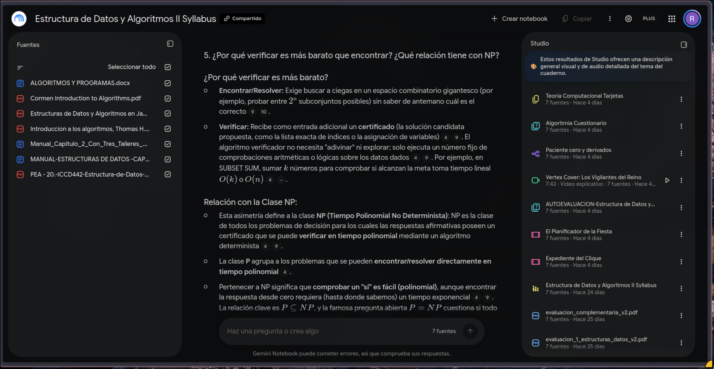

# Anexo de evidencias NotebookLM

## Pregunta 01

**¿Qué es 3-SAT y qué diferencia hay con SAT general?**

**Respuesta de NotebookLM:** La captura define SAT como la existencia de una
asignación que hace verdadera una fórmula en CNF y presenta 3-SAT como el caso
restringido en que cada cláusula contiene exactamente (o como máximo) tres
literales. También distingue que SAT general admite un número arbitrario de
literales por cláusula.

**Fuente citada:** Cuaderno compartido **“Estructura de Datos y Algoritmos II
Syllabus”**. Marcador visible: **[1]**. En el panel izquierdo se ven
“ALGORITMOS Y PROGRAMAS.docx”, “Cormen Introduction to Algorithm...”,
“Estructuras de Datos y Algoritmos ...” e “Introducción a los algoritmos,
Tho...”. Página exacta: **no visible en la captura**.

## Pregunta 02

**¿Por qué 3-SAT es NP-completo? Explica la reducción desde SAT.**

**Respuesta de NotebookLM:** En las capturas se afirma que el teorema de
Cook–Levin estableció que SAT es NP-completo. La respuesta relaciona ese hecho
con la reducción de SAT a 3-SAT: al transformar una instancia general en una
instancia ternaria equivalente, la dificultad de SAT se transfiere a 3-SAT.

**Fuente citada:** Cuaderno compartido **“Estructura de Datos y Algoritmos II
Syllabus”**. Marcadores visibles: **[2], [3], [4] y [5]**. En el panel
izquierdo se ven “ALGORITMOS Y PROGRAMAS.docx”, “Cormen Introduction to
Algorithm...”, “Estructuras de Datos y Algoritmos ...” e “Introducción a los
algoritmos, Tho...”. Página exacta: **no visible en la captura**.

## Pregunta 03

**¿Por qué 2-SAT es polinomial pero 3-SAT no se conoce que lo sea?**

**Respuesta de NotebookLM:** 2-SAT se modela como un grafo de implicaciones y
es satisfacible si ninguna variable `x` queda en la misma componente fuertemente
conexa que `¬x`. Se resuelve en tiempo lineal `O(V+E)`. Una cláusula de tres
literales no se reduce a implicaciones binarias; como 3-SAT es NP-completo, un
algoritmo polinomial implicaría `P=NP`.

**Fuente citada:** Cuaderno compartido **“Estructura de Datos y Algoritmos II
Syllabus”**. Marcadores visibles: **[3], [5], [6] y [7]**. En el panel
izquierdo se ven “ALGORITMOS Y PROGRAMAS.docx”, “Cormen Introduction to
Algorithm...”, “Estructuras de Datos y Algoritmos ...” e “Introducción a los
algoritmos, Tho...”. Página exacta: **no visible en la captura**.

## Pregunta 04

**¿Cuál es la complejidad de la búsqueda exhaustiva y del backtracking, y de dónde sale?**

**Respuesta de NotebookLM:** La búsqueda exhaustiva cuesta `O(2^n)` u
`O(n·2^n)`: enumera las `2^n` combinaciones y evalúa los `n` elementos. El
backtracking tiene peor caso `O(2^n)`, porque recorre un árbol de decisión
binario, aunque puede podar ramas.

**Fuente citada:** Cuaderno compartido **“Estructura de Datos y Algoritmos II
Syllabus”**. Marcadores visibles: **[10], [11] y [12]**. En el panel izquierdo
se ven “ALGORITMOS Y PROGRAMAS.docx”, “Cormen Introduction to Algorithm...”,
“Estructuras de Datos y Algoritmos ...” e “Introducción a los algoritmos,
Tho...”. Página exacta: **no visible en la captura**.

## Pregunta 05

**¿Por qué verificar es más barato que encontrar? ¿Qué relación tiene con NP?**

**Respuesta de NotebookLM:** Encontrar exige explorar un espacio combinatorio
que puede tener `2^n` posibilidades; verificar recibe un certificado, como una
asignación, y solo comprueba sus cláusulas. La captura relaciona esta asimetría
con NP: verificar una respuesta afirmativa puede hacerse en tiempo polinomial,
aunque encontrarla no sea conocido como polinomial.

**Fuente citada:** Cuaderno compartido **“Estructura de Datos y Algoritmos II
Syllabus”**. Marcadores visibles: **[4], [9] y [10]**. En el panel izquierdo se
ven “ALGORITMOS Y PROGRAMAS.docx”, “Cormen Introduction to Algorithm...”,
“Estructuras de Datos y Algoritmos ...” e “Introducción a los algoritmos,
Tho...”. Página exacta: **no visible en la captura**.
