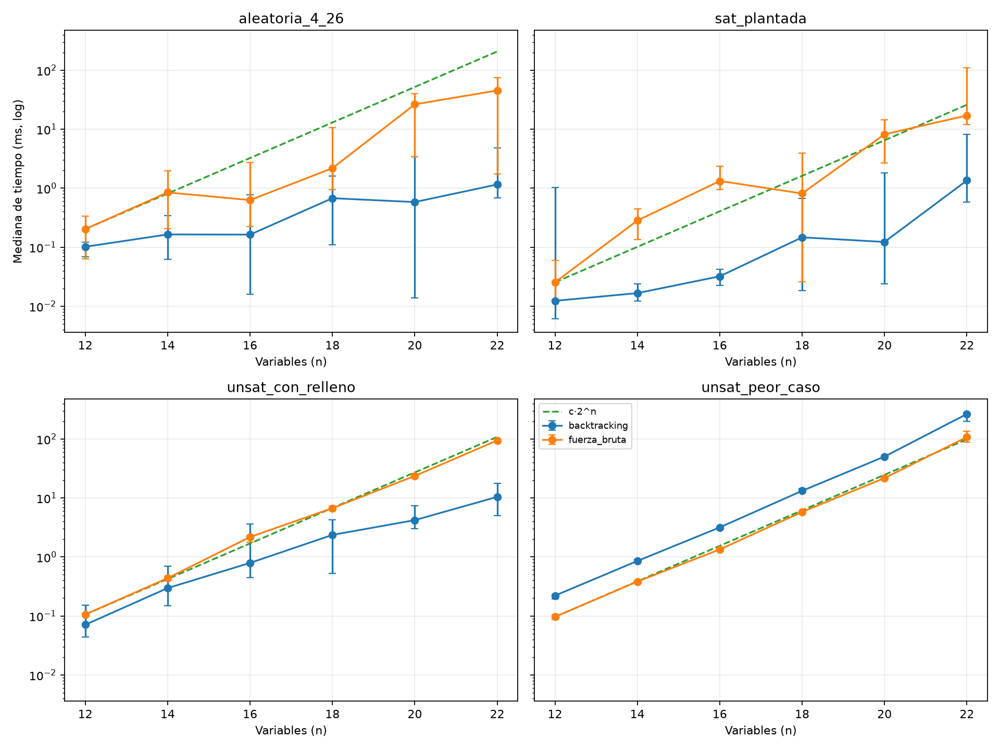
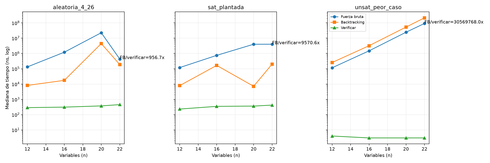
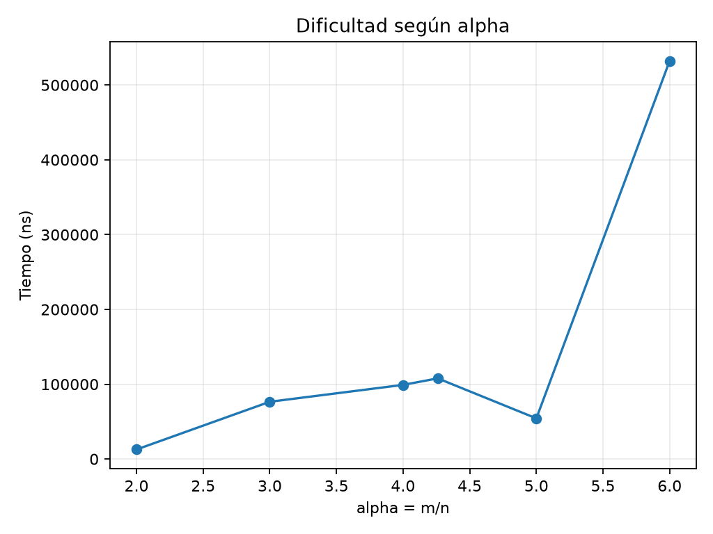

# Informe técnico — Tema 2: 3-SAT

## 1. Portada

**[Nombre Apellido] — [Nombre Apellido]**  
Ingeniería en Ciencias de la Computación, [curso], [fecha].  
Proyecto Integrador — Unidad 2: Complejidad Computacional.

## 2. Introducción

Este proyecto implementa un configurador de opciones compatibles como una
fórmula 3-CNF. Cada opción es una variable booleana y cada restricción es una
cláusula de tres posiciones. El sistema decide SAT/UNSAT y muestra una
configuración cuando existe.

## 3. Objetivos

Representar y validar fórmulas, resolverlas con fuerza bruta y backtracking,
comparar encontrar frente a verificar, contrastar 2-SAT y producir mediciones
reproducibles sin bibliotecas SAT externas.

## 4. Descripción del problema

Una instancia contiene n variables y m cláusulas. Los literales positivos
representan seleccionar una opción y los negativos excluirla. La consola
permite ingresar, cargar, generar, validar, resolver y comparar configuraciones.

## 5. Fundamentos teóricos

SAT pregunta si una fórmula booleana es satisfacible. 3-SAT exige exactamente
tres posiciones por cláusula y pertenece a NP porque una asignación se verifica
en tiempo lineal en m. Es NP-difícil porque toda cláusula de SAT se transforma
en cláusulas ternarias equisatisfacibles: las cortas se rellenan y las largas
usan variables auxiliares. Cook–Levin codifica computaciones no deterministas
como SAT y establece la completitud de SAT. 2-SAT, en cambio, se resuelve con
SCC en `Θ(n+m)`.

## 6. Diseño y pseudocódigo

La fuerza bruta recorre máscaras `0..2^n-1`; el backtracking asigna cada variable
y poda cuando una cláusula queda totalmente falsa. El verificador evalúa tres
literales por cláusula. Los pseudocódigos completos están en
`../diagramas/pseudocodigo/`.

## 7. Estructuras de datos

`Formula` usa una lista de arreglos de enteros; el signo codifica negación.
`Resultado` contiene SAT, certificado, nodos, hojas, tiempo y profundidad.
La máscara evita arreglos temporales por asignación. 2-SAT usa dos nodos por
variable y listas de adyacencia.

## 8. Implementación en Java

`formula-service` analiza y valida; `solver-service` implementa fuerza bruta,
backtracking, 2-SAT y reducción; `generator-service` crea familias; 
`benchmark-service` mide; `console-app` orquesta el menú. Todo compila con
`javac --release 17` y solo usa APIs del JDK.

## 9. Pruebas funcionales

La suite ejecuta 200 fórmulas pequeñas, 500 equivalencias 3-SAT, 200
comparaciones 2-SAT y 100 reducciones. También verifica repetición, tautología,
literal cero, rango, cláusulas inválidas y entrada no numérica.

## 10. Complejidad temporal y espacial

Validar y verificar cuestan `Θ(m)` en el peor caso. Fuerza bruta cuesta
`Θ(2^n·m)` y usa `O(n+m)`; backtracking tiene peor caso
`O(2^n·m)`, profundidad `≤n` y espacio adicional `O(n)`. 2-SAT cuesta
`Θ(n+m)`. La derivación completa está en `fase4_complejidad.md`.

## 11. Resultados experimentales y gráficas

El benchmark usa cinco repeticiones, calentamiento y familias aleatoria,
plantada y UNSAT peor caso. Las tablas se generan desde `../data/resultados/`.

## 12. Discusión

El resultado UNSAT peor caso recorre el árbol completo, mientras que instancias
SAT pueden terminar antes. Las diferencias entre mediciones se explican por
JIT, cachés y el orden de las cláusulas. La verificación pura excluye la
validación estructural para medir el costo del certificado.

## 13. Conclusiones

La implementación muestra experimentalmente que encontrar una asignación puede
ser exponencial, pero verificarla es lineal en las cláusulas. Backtracking
reduce nodos en muchas instancias, aunque conserva la cota exponencial.

## 14. Referencias

Cook (1971), Karp (1972), Sipser, Cormen et al., Garey–Johnson y
Davis–Logemann–Loveland. La lista bibliográfica se mantiene en
`../text/referencias.md`.

## 15. Anexo NotebookLM

**PENDIENTE: completar con evidencias reales del cuaderno del docente.**
Usar `anexo_notebooklm/anexo_plantilla.md`; no se incluyen respuestas ni
capturas inventadas.
